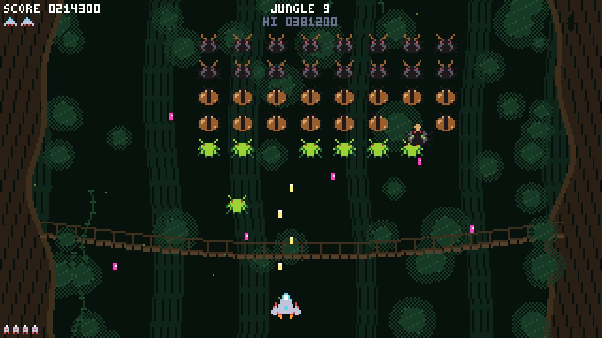
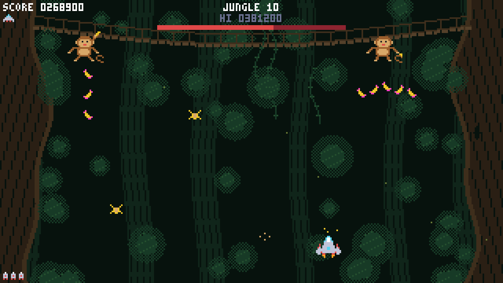
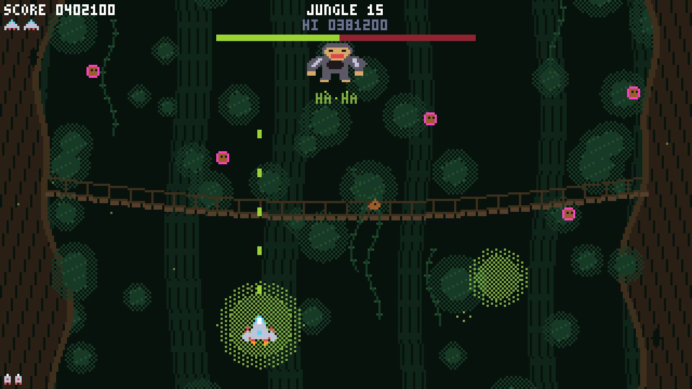
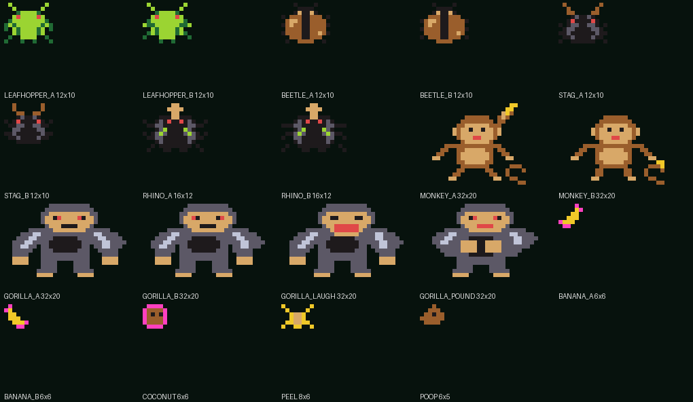
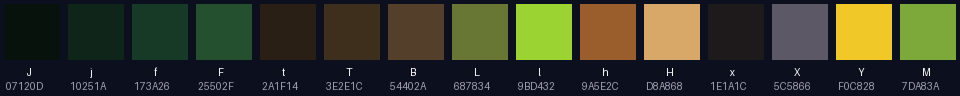

# Plan: level 2, the jungle (insects, a heavy beetle, monkeys and gorillas)

For the implementer: follow the steps in order. Every design choice below is final, so don't redesign anything.
Read only the files each step names, and don't re-read a file after editing it. Code style: follow `CLAUDE.md` and
the existing code (plain C++14, no new libraries, short one-line comments, no helpers for one-off logic).
Don't commit: the user commits. When done, list the changed files and suggest a one-line commit message.

Source: the user's "jungle level design" PDF (one page) and their answers on 2026-11-18. Mockups and the art source:
`docs/work-plan/jungle/` (`make_jungle_mockups.py` draws every image below; its `NEW_PALETTE`, `NEW_SPRITES` and
`build_jungle` are the exact palette, sprites and background generator you add to the game).

## What the player gets

| A formation wave (jungle 9) | Twin monkeys (jungle 10) | The gorilla (jungle 15) |
|---|---|---|
|  |  |  |

New sprites (×6) and palette:  

### Flow
```
MAIN MENU ─ CLASSIC ─→ level 1 (waves 1-20) ─ LEVEL 1 CLEAR (3 s) ─→ JUNGLE (waves 1-20) ─ JUNGLE CLEAR (3 s) ─→ end screen (win)
          ├ JUNGLE ──────────────────────────────────────────────────→ JUNGLE (waves 1-20) ─ ...
          └ SETTINGS
```
- Main menu items: `CLASSIC`, `JUNGLE`, `SETTINGS`. JUNGLE starts a fresh run at the jungle (3 lives, 3 rockets, weapon 1).
  It is always available for now; locking it until level 1 is beaten is a later feature (out of scope).
- Beating level 1 (CLASSIC) continues the same run into the jungle: score, lives, rockets and weapon level carry over.
- The jungle restarts the wave count: banner `JUNGLE` for 2 s, then `WAVE 1`; the HUD top centre reads `JUNGLE n`
  (level 1 keeps `WAVE n`). Killing the jungle's wave-20 bosses shows `JUNGLE CLEAR` for 3 s, then the end-screen panel
  titled `JUNGLE CLEAR` in yellow; its score line reads `SCORE n   JUNGLE 20`. "Play again" restarts at the level the
  menu started (CLASSIC → level 1, JUNGLE → jungle).

### Look (pillar 1: nothing hides a shot)
- Background: a dark, leafy, retro rainforest that scrolls down slowly, in two layers plus fireflies:
  far layer (8 px/s) of thin dark trunks and dithered leaf clusters; near layer (18 px/s) with two big twisted bark
  trunks at the screen edges, knot holes, two sagging rope bridges, hanging vines and leaf clumps; 14 dim fireflies that
  drift and blink (22 px/s). Every background pixel is darker than the grey stars (`s`), so shots, ships and insects pop.
- Enemies are insects in insect colours, same roles as level 1's aliens:

| Role (code type) | Jungle insect | HP | Score | Sprite |
|---|---|---|---|---|
| `ALIEN_GREEN` | lime leafhopper | 1 | 100 | `LEAFHOPPER_A/B` 12×10 |
| `ALIEN_BLUE` | brown beetle | 2 | 200 | `BEETLE_A/B` 12×10 |
| `ALIEN_RED` | black stag beetle (brown mandibles, red eyes) | 4 | 400 | `STAG_A/B` 12×10 |
| `ALIEN_HEAVY` (new) | black rhinoceros beetle, tan horn, green sheen | 12 | 1,000 | `RHINO_A/B` 16×12 |

- **Magenta now marks every deadly enemy projectile:** enemy shots, flying bananas (yellow with magenta tips) and
  coconuts (brown with a magenta ring). Harmless things never use magenta: peels, flying poop, mist.

### Waves (difficulty)
- Jungle wave n uses level 1's formulas at wave n + 5 ("difficulty wave"): rows, armour rows, sway, shot chance, shot
  speed, dive interval, divers from difficulty wave 3, two divers from difficulty wave 15. So jungle wave 1 = 5 rows
  (2 brown beetle rows + 3 leafhopper rows) and divers, jungle wave 8+ has 2 stag + 2 beetle rows, everything is capped
  by jungle wave 15.
- **Heavy rhino beetles:** jungle formation waves get `wave / 8` of them (waves 8–14: 1, waves 16–19: 2; none on boss
  waves and none in level 1). They fly in like aliens to a start point, then roam freely instead of joining the
  formation: they bounce around the box x 0…304, y 18…84 at 40 px/s sideways and 25 px/s vertically, never dive, and
  shoot at twice the formation's shot chance. They count for the wave clear.

### Bosses (n = wave / 5)
| Wave | Bosses | HP each | Sway | Attack every | Reward each |
|---|---|---|---|---|---|
| 5 | 1 monkey | 150 | 50 px/s, full width | 2.2 s | 25,000 |
| 10 | 2 monkeys (twins, own halves, as level 1) | 150 | 60 | 2.0 s each | 30,000 |
| 15 | 1 gorilla | 300 | 45 | 1.8 s × random 0.6–1.4 | 35,000 |
| 20 | 2 gorillas (twins) | 300 | 55 | 1.6 s × random 0.6–1.4 each | 40,000 |

Reward = 5,000 × (n + 4). Entry, twins' halves, health bar, flash, rocket damage, pickups on death, wave-clear bonus:
all as level 1's bosses. Bosses keep the 32×20 box.

- **Monkey** alternates two attacks:
  - *Banana throw* (from the PDF): 3 bananas 0.15 s apart fall **straight down** (85 px/s) from the monkey's centre; at
    the throw it also lobs a banana **peel** (screech sound) that leaves 0.45 s later and lands 0.8 s after that on a
    random point of the ship zone (x 8…312, y 107…173).
  - *Banana bunch* (new): 5 bananas in a fan, sideways −50…+50 px/s, down 75 px/s.
- **Gorilla** rolls each attack: 30 % banana throw (with peel), 30 % poop throw, 20 % banana bunch, 20 % chest pound.
  - *Poop throw* (from the PDF): lobs a poop at the nearest ship's position (0.8 s flight, harmless in the air); it splats
    into a **stink mist** there. If 3 mists (or poops in flight) already exist it does a banana bunch instead.
  - *Chest pound* (new): drums its chest for 0.6 s (pound sound, sprite alternates every 0.1 s), then a small shake and
    5 coconuts fall from the top, one at a random x in each fifth of the screen, at 110 px/s. Rolled again while
    pounding → banana bunch.
- **Banana peel:** lies 5 s (blinks in its last second). A ship whose hitbox touches it slips: it slides 0.5 s at
  140 px/s in the direction the stick was pushed (left or right at random if the stick was centred), ignoring the
  stick but still able to shoot, shaking (1 px jitter) and leaving tan dust; then it is **stunned for 1.0 s**: it
  can't move, shoot or fire rockets, jitters, and 3 yellow dizzy stars circle above it. The peel is squashed (gone).
  Peels don't kill and work even on an invincible (respawning) ship.
- **Stink mist:** a dithered sickly-green circle that grows to radius 20 px in 0.3 s, shimmers, thins out in its last
  second and is gone after 6 s. While a ship's centre is inside any mist, **that player's bullets heal gorillas instead
  of damaging them** (+1 HP each, up to max) and are drawn lime instead of yellow. A heal makes the gorilla laugh for
  0.6 s: laugh sprite, `HA HA` in mist green under it, the health bar fills lime, laugh sound (once per laugh, not per
  bullet). Rockets are unaffected (pillar 2: the rocket always works). Decided: the check happens when the bullet hits
  (the owner's ship is in a mist at that moment), not when it was fired.

### Sounds (synthesized, like the others)
| Sound | When | Tones `{start s, length s, start Hz, end Hz, volume, noise}` |
|---|---|---|
| `SOUND_BANANA_THROW` | gorilla throw, bunch, poop lob | `{0, 0.12, 2000, 600, 0.2, noise}` |
| `SOUND_SCREECH` | monkey banana throw | `{0, 0.08, 1400, 1900, 0.2}`, `{0.08, 0.08, 1900, 1300, 0.2}`, `{0.18, 0.08, 1500, 2000, 0.2}` |
| `SOUND_SLIP` | ship steps on a peel (slide whistle) | `{0, 0.35, 1400, 300, 0.3}` |
| `SOUND_STUN` | slide ends, stun starts (boing) | `{0, 0.12, 200, 450, 0.3}`, `{0.12, 0.15, 450, 180, 0.3}` |
| `SOUND_SPLAT` | poop lands | `{0, 0.25, 700, 90, 0.4, noise}` |
| `SOUND_LAUGH` | gorilla healed (ha-ha-ha) | `{0, 0.09, 330, 260, 0.35}`, `{0.13, 0.09, 300, 240, 0.35}`, `{0.26, 0.09, 270, 210, 0.35}` |
| `SOUND_POUND` | chest pound starts | `{0, 0.1, 300, 80, 0.45, noise}`, `{0.2, 0.1, 300, 80, 0.45, noise}`, `{0.4, 0.15, 250, 60, 0.5, noise}` |

The song stays the player's choice from Settings (no jungle track; out of scope).

### Required technology
Nothing new: C++14, the CPU pixel buffer (D-008), sprites as text grids (D-006), SFX synthesized by `audio.cpp`'s
`synthesize`, SDL2 only in `main.cpp`/`audio.cpp`/`input.cpp`. The background is generated once in code into two
320×360 tiles (≈0.9 MB static memory) and copied row by row each frame: no image files, no alpha blending, no
`SDL_RenderCopy` tricks. Python + Pillow only for the mockup images in `docs/`.

Out of scope: unlocking JUNGLE only after level 1, a jungle ship skin, a jungle song, new XMB art (don't rerun
`make_xmb_art.py`).

## Step 1: data (`source/sprites.h`, `source/game.h`)
`sprites.h`:
- In `paletteColor`, after `case 'p'`, add one `case` per entry of `NEW_PALETTE` in
  `docs/work-plan/jungle/make_jungle_mockups.py`, in its order, as `case 'J': return 0xFF07120D;   // jungle: deepest shade`
  (alpha `FF` + the hex value, the script's comment as the comment). Change the comment above `paletteColor` to
  `// Palette: one character per colour (ARGB). Magenta 'm' is only for deadly enemy projectiles.`
- After `ROCKET_ICON`, add every entry of `NEW_SPRITES` from the same script, in its order, copied verbatim, in the
  existing style: `const Sprite LEAFHOPPER_A = {12, 10,` then one quoted row per line (rows are `w` characters; split the
  script's concatenated string every `w` characters). Keep the script's `#` comments as `//` comments.

`game.h`:
- `enum Sound`: add `SOUND_BANANA_THROW, SOUND_SCREECH, SOUND_SLIP, SOUND_STUN, SOUND_SPLAT, SOUND_LAUGH, SOUND_POUND`
  before `SOUND_COUNT`.
- `struct Player`, after `nextExtraLife`:
```cpp
    float slideTimer;        // s left of a banana-peel slide (jungle)
    float slideVX, slideVY;  // slide direction, a unit vector
    float stunTimer;         // s the ship can't move, shoot or fire rockets after a slide
    bool inMist;             // the ship's centre is in a stink mist: this player's bullets heal gorillas
```
- `enum AlienType { ALIEN_GREEN, ALIEN_BLUE, ALIEN_RED, ALIEN_HEAVY };   // roles; level 2 draws them as insects`
- `enum AlienState`: add `ALIEN_ROAMING` (the heavy's free flight).
- `struct Alien`: after `vx`, add `float vy;            // roaming heavy: vertical speed`.
- `enum BossType { BOSS_CLASSIC, BOSS_MAGE, BOSS_MONKEY, BOSS_GORILLA };`
- `struct Boss`, before `alive`:
```cpp
    float laughTimer;        // gorilla: s of laughing left after a heal
    float poundTimer;        // gorilla: s of chest pounding left before the coconuts fall; 0 when not pounding
```
- After `struct Pickup`, add:
```cpp
enum ThrownKind { THROWN_BANANA, THROWN_COCONUT };
struct Thrown { float x, y, vx, vy; ThrownKind kind; };          // a deadly banana or coconut; top-left of its 6x6 sprite
struct Lob { float fromX, fromY, toX, toY, age; bool poop; };    // a harmless peel or poop in flight; waits while age < 0
struct Peel { float x, y, life; };                               // a peel lying in the ship zone; top-left of its 8x6 sprite
struct Mist { float x, y, age; };                                // a stink mist centred at x, y
```
- `struct Game`: after `bosses` add `std::vector<Thrown> thrown;` `std::vector<Lob> lobs;` `std::vector<Peel> peels;`
  `std::vector<Mist> mists;` (one per line, a short comment each); after `wave` add `int level;   // 1 space, 2 jungle`;
  after `swayOffset, swayDirection` add `float sceneryTime;     // s the jungle background has scrolled`.
- Declarations: replace `startGame`, `bossHealth`, `bossType` and add two:
```cpp
void startGame(Game& game, int playerCount, uint32_t seed, int level = 1);   // level 2 starts at the jungle
int bossHealth(int level, int wave);       // HP of each boss: classic 100, mage 200, monkey 150, gorilla 300
BossType bossType(int level, int wave);    // level 1: classic, mage from wave 15; jungle: monkey, gorilla from wave 15
int difficultyWave(int level, int wave);   // the level-1 wave whose formation numbers a wave uses: jungle n plays as n + 5
int heavyCount(int level, int wave);       // roaming heavy beetles: jungle formation waves get wave / 8
```

## Step 2: rules in `source/game.cpp` (waves, heavies, bosses, hazards)
Constants: replace `ALIEN_HP`, `ALIEN_SCORE` with 4-entry arrays `{1, 2, 4, 12}` and `{100, 200, 400, 1000}`. Replace
`ALIEN_W, ALIEN_H` (keep `SHIP_W, SHIP_H` on that line) with `const int ALIEN_WIDTH[4] = {12, 12, 12, 16}, ALIEN_HEIGHT[4] = {10, 10, 10, 12};`.
Replace `ALIEN_SPRITES` and `ALIEN_COLORS` with per-level tables (index `[game.level - 1]`):
```cpp
const Sprite* const ALIEN_SPRITES[2][4][2] = {
    {{&GREEN_ALIEN_A, &GREEN_ALIEN_B}, {&BLUE_ALIEN_A, &BLUE_ALIEN_B}, {&RED_ALIEN_A, &RED_ALIEN_B}, {&RHINO_A, &RHINO_B}},
    {{&LEAFHOPPER_A, &LEAFHOPPER_B}, {&BEETLE_A, &BEETLE_B}, {&STAG_A, &STAG_B}, {&RHINO_A, &RHINO_B}}};
const char ALIEN_COLORS[2][4] = {{'g', 'u', 'r', 'X'}, {'l', 'h', 'X', 'H'}};   // death particles
```
Add after the Level 1 block:
```cpp
// Jungle (jungle/design.md)
const int JUNGLE_WAVE_OFFSET = 5;      // jungle wave n uses level 1's formation numbers for wave n + 5
const int HEAVY_EVERY = 8;             // heavies per jungle formation wave: wave / 8
const float HEAVY_SPEED_X = 40, HEAVY_SPEED_Y = 25;   // px/s
const float HEAVY_MIN_Y = 18, HEAVY_MAX_Y = 84;       // px, the roaming box's top and bottom (sprite top)
const float HEAVY_SHOT_FACTOR = 2;     // x the formation's shot chance
const int JUNGLE_BOSS_HP[4] = {150, 150, 300, 300};              // by n - 1, n = wave / 5
const float JUNGLE_BOSS_SPEED[4] = {50, 60, 45, 55};             // px/s
const float JUNGLE_BOSS_INTERVAL[4] = {2.2f, 2.0f, 1.8f, 1.6f};  // s
const int JUNGLE_REWARD_OFFSET = 4;    // jungle boss n pays BOSS_REWARD x (n + 4)
const float BANANA_SPEED = 85;         // px/s, straight down
const int BUNCH_BANANAS = 5;
const float BUNCH_DOWN_SPEED = 75, BUNCH_SIDEWAYS = 50;   // px/s
const float GORILLA_THROW_CHANCE = 0.3f, GORILLA_POOP_CHANCE = 0.3f, GORILLA_BUNCH_CHANCE = 0.2f;   // the rest is a pound
const float LOB_TIME = 0.8f, LOB_ARC = 40, PEEL_DELAY = 0.45f;   // s, px, s
const float PEEL_LIFE = 5, PEEL_BLINK = 1;   // s
const int PEEL_W = 8, PEEL_H = 6;
const float SLIDE_TIME = 0.5f, SLIDE_SPEED = 140, STUN_TIME = 1.0f;   // s, px/s, s
const float MIST_RADIUS = 20, MIST_GROW = 0.3f, MIST_TIME = 6, MIST_FADE = 1;   // px, s, s, s
const int MAX_MISTS = 3;               // mists plus poops in flight
const float LAUGH_TIME = 0.6f, POUND_TIME = 0.6f, TRAUMA_POUND = 0.25f;
const int COCONUTS = 5;
const float COCONUT_SPEED = 110;       // px/s
const int THROWN_SIZE = 6, THROWN_HITBOX = 4;   // px: sprite, and the deadly square inside it (1 px in)
const int JUNGLE_TILE_H = 360, FIREFLIES = 14;   // px (two screens, wraps), count
const float JUNGLE_FAR_SPEED = 8, JUNGLE_MID_SPEED = 18, FIREFLY_SPEED = 22;   // px/s
```

Formulas (next to `bossCount`):
- `difficultyWave`: `return wave + (level == 2 ? JUNGLE_WAVE_OFFSET : 0);`
- `heavyCount`: `return level == 2 && !isBossWave(wave) ? wave / HEAVY_EVERY : 0;`
- `bossHealth(level, wave)`: level 2 → `JUNGLE_BOSS_HP[wave / 5 - 1]`, else today's body.
- `bossType(level, wave)`: level 2 → `wave >= MAGE_WAVE ? BOSS_GORILLA : BOSS_MONKEY`, else today's body.
- `bossAttackInterval(int level, int wave)`: level 2 → `JUNGLE_BOSS_INTERVAL[wave / 5 - 1]`, else today's body. Update
  both call sites (`startWave`, `updateBoss` with `game.level, game.wave`).

Sizes: replace every `ALIEN_W` / `ALIEN_H` with `ALIEN_WIDTH[alien.type]` / `ALIEN_HEIGHT[alien.type]` (in `damageAlien`,
`explode`, `updateAlien`, and `updateGame`'s bullet, rocket and ship-contact loops). In `explode`, compute `reach`
inside the loop (it depends on the type). In `startWave`, the formation `left` uses `ALIEN_WIDTH[ALIEN_GREEN]`.
`damageAlien`'s particles use `ALIEN_COLORS[game.level - 1][alien.type]`.

Difficulty: wherever a formation number reads `game.wave` / `wave`, use the difficulty wave instead:
- `startWave`: `int dw = difficultyWave(game.level, wave);` then `formationRows(dw)`, `redRows`/`blueEnd` compare `dw`,
  `game.diveTimer = diveInterval(dw)`. Boss set-up keeps `wave` but uses `bossType(game.level, wave)`,
  `bossHealth(game.level, wave)`, and `speed = game.level == 2 ? JUNGLE_BOSS_SPEED[wave / 5 - 1] : <today's formula>`.
- `updateAlien`: `shotChance(...)` and `enemyShotSpeed(...)` take `difficultyWave(game.level, game.wave)`; the chance is
  multiplied by `HEAVY_SHOT_FACTOR` for `ALIEN_HEAVY`.
- `updateGame`: `swaySpeed` uses the difficulty wave; the dive block's `game.wave >= 3` and `diveInterval` too.
- `startDive`: `TWO_DIVERS_WAVE` compares the difficulty wave.
- Banner: `game.bannerTimer = BANNER_TIME + (wave == 1 ? LEVEL_BANNER_TIME : 0)` stays (both levels open with a banner).

`startWave`, formation loop: `Alien alien;` → `Alien alien = {};`. After the loop, add the heavies:
```cpp
    for (int i = 0; i < heavyCount(game.level, wave); i++) {   // roaming heavy beetles (jungle rule)
        Alien heavy = {};
        heavy.type = ALIEN_HEAVY;
        heavy.state = ALIEN_ENTERING;
        heavy.slotX = i == 0 ? 60 : 244;
        heavy.slotY = 70;
        heavy.x = heavy.slotX + game.swayOffset;
        heavy.y = heavy.slotY - ENTRY_DISTANCE;
        heavy.vx = i == 0 ? HEAVY_SPEED_X : -HEAVY_SPEED_X;
        heavy.vy = HEAVY_SPEED_Y;
        heavy.entryDelay = 0.6f + 0.4f * i;
        heavy.hp = ALIEN_HP[ALIEN_HEAVY];
        heavy.alive = true;
        game.aliens.push_back(heavy);
    }
```
`startGame`: takes `int level`; set `game.level = level;` before `startWave(game, 1)`.

`updateAlien`:
- `ALIEN_ENTERING`, on reaching the slot: `alien.state = alien.type == ALIEN_HEAVY ? ALIEN_ROAMING : ALIEN_IN_FORMATION;`
- New case: `ALIEN_ROAMING`: move by `vx, vy` × dt; if `x` leaves `0 … SCREEN_W - ALIEN_WIDTH[ALIEN_HEAVY]` clamp it and
  flip `vx`; if `y` leaves `HEAVY_MIN_Y … HEAVY_MAX_Y` clamp it and flip `vy`.
- `canShoot` also for `ALIEN_ROAMING`. (`startDive` only picks `ALIEN_IN_FORMATION`, so heavies never dive.)

`killPlayer`: add `player.slideTimer = player.stunTimer = 0;`.

`updatePlayer` (alive branch), replace the two `player.x = … / player.y = …` lines with:
```cpp
    if (player.stunTimer > 0) {   // dizzy after a slide: no moving, shooting or rockets
        player.stunTimer = std::max(0.0f, player.stunTimer - dt);
        player.fireTimer = std::max(0.0f, player.fireTimer - dt);
        player.rocketPressedAt = -1;
        return;
    }
    float vx = a.moveX * SHIP_SPEED, vy = a.moveY * SHIP_SPEED;
    if (player.slideTimer > 0) {   // slipping on a peel: the stick does nothing, the gun still works
        vx = player.slideVX * SLIDE_SPEED;
        vy = player.slideVY * SLIDE_SPEED;
        spawnParticles(game, player.x + SHIP_W / 2.0f, player.y + SHIP_H, 1, paletteColor('H'), 20);
        player.slideTimer -= dt;
        if (player.slideTimer <= 0) {
            player.slideTimer = 0;
            player.stunTimer = STUN_TIME;
            game.soundRequested[SOUND_STUN] = true;
        }
    }
    player.x = std::max(0.0f, std::min(player.x + vx * dt, (float)(SCREEN_W - SHIP_W)));
    player.y = std::max(MOVE_ZONE_TOP, std::min(player.y + vy * dt, (float)(SCREEN_H - SHIP_H)));
    if (player.slideTimer == 0 && player.stunTimer == 0) {
        for (Peel& peel : game.peels) {   // stepping on a peel starts a slide the way the stick points
            if (peel.life <= 0 || !overlap(peel.x, peel.y, PEEL_W, PEEL_H, player.x + HITBOX_X, player.y + HITBOX_Y, HITBOX, HITBOX)) continue;
            float length = sqrtf(a.moveX * a.moveX + a.moveY * a.moveY);
            player.slideVX = length < 0.2f ? (randomUnit(game) < 0.5f ? -1.0f : 1.0f) : a.moveX / length;
            player.slideVY = length < 0.2f ? 0 : a.moveY / length;
            player.slideTimer = SLIDE_TIME;
            peel.life = 0;   // squashed; removed in updateGame
            game.soundRequested[SOUND_SLIP] = true;
            break;
        }
    }
```
(The fire and rocket code below stays as it is.)

`damageBoss`: reward `BOSS_REWARD * (game.wave / 5 + (game.level == 2 ? JUNGLE_REWARD_OFFSET : 0))`; on death also
`boss.laughTimer = boss.poundTimer = 0;` (a dead gorilla drops no coconuts).

`updateBoss`:
- First line after the flash: `boss.laughTimer = std::max(0.0f, boss.laughTimer - dt);`
- After the ball/beam block (before the target search, so a started pound finishes even with no ship alive):
```cpp
    if (boss.poundTimer > 0) {
        boss.poundTimer -= dt;
        if (boss.poundTimer <= 0) {   // the pound shakes coconuts loose: one at a random x in each fifth of the screen
            boss.poundTimer = 0;
            float lane = (SCREEN_W - THROWN_SIZE) / (float)COCONUTS;
            for (int i = 0; i < COCONUTS; i++)
                game.thrown.push_back({(i + randomUnit(game)) * lane, (float)-THROWN_SIZE, 0, COCONUT_SPEED, THROWN_COCONUT});
            feedback(game, TRAUMA_POUND, 0, 0);
        }
    }
```
- Next to `centreX, bottomY` add `bool jungle = boss.type == BOSS_MONKEY || boss.type == BOSS_GORILLA;`.
- Attack choice: attack ids are `0` burst/banana throw, `1` fan/banana bunch, `2` power ball, `3` poop, `4` pound.
  The alternation applies to `BOSS_CLASSIC || BOSS_MONKEY`; today's mage `else` becomes `else if (boss.type == BOSS_MAGE)`;
  add a gorilla `else`:
```cpp
        } else {   // gorilla: random order and gaps like the mage
            float roll = randomUnit(game);
            attack = roll < GORILLA_THROW_CHANCE ? 0 : roll < GORILLA_THROW_CHANCE + GORILLA_POOP_CHANCE ? 3
                   : roll < GORILLA_THROW_CHANCE + GORILLA_POOP_CHANCE + GORILLA_BUNCH_CHANCE ? 1 : 4;
            int stink = (int)game.mists.size();
            for (const Lob& lob : game.lobs) stink += lob.poop;
            if ((attack == 3 && stink >= MAX_MISTS) || (attack == 4 && boss.poundTimer > 0)) attack = 1;
            boss.attackTimer *= MAGE_GAP_MIN + (MAGE_GAP_MAX - MAGE_GAP_MIN) * randomUnit(game);
        }
```
- Attack execution:
  - `0`: as today (`burstShotsLeft = BOSS_BURST_SHOTS`, `burstTimer = 0`); if `jungle`, also lob a peel:
    `toX = 8 + randomUnit(game) * (SCREEN_W - 16)`, then `toY = MOVE_ZONE_TOP + 7 + randomUnit(game) * (SCREEN_H - MOVE_ZONE_TOP - 14)`
    (two statements, in this order), `game.lobs.push_back({centreX, bottomY, toX, toY, -PEEL_DELAY, false})`, and request
    `SOUND_SCREECH` for a monkey, `SOUND_BANANA_THROW` for a gorilla.
  - `1`: if `jungle`, `BUNCH_BANANAS` bananas `{centreX - THROWN_SIZE / 2.0f, bottomY, sideways, BUNCH_DOWN_SPEED, THROWN_BANANA}`
    with `sideways` = −50, −25, 0, 25, 50 (the fan's formula with `BUNCH_BANANAS`, `BUNCH_SIDEWAYS`) and `SOUND_BANANA_THROW`;
    else today's fan.
  - `2`: today's power ball.
  - `3`: poop at the target: `toX = std::max(8.0f, std::min(target->x + SHIP_W / 2.0f, SCREEN_W - 8.0f))`,
    `toY = std::max(MOVE_ZONE_TOP + 7, std::min(target->y + SHIP_H / 2.0f, SCREEN_H - 7.0f))`,
    `game.lobs.push_back({centreX, bottomY, toX, toY, 0, true})`, `SOUND_BANANA_THROW`.
  - `4`: `boss.poundTimer = POUND_TIME;` `SOUND_POUND`.
- Burst shots: if `jungle`, each shot is `game.thrown.push_back({centreX - THROWN_SIZE / 2.0f, bottomY, 0, BANANA_SPEED, THROWN_BANANA})`
  (straight down), else today's aimed shot.

`updateBackground`: add `game.sceneryTime += dt;`.

`updateGame`:
- After the `updatePlayer` loop, compute `inMist` for every player (false when dead): the ship centre
  `(x + SHIP_W / 2, y + SHIP_H / 2)` within `MIST_RADIUS * std::min(mist.age / MIST_GROW, 1.0f)` of any mist centre.
- Bullet-vs-boss loop: replace the `damageBoss` call with
```cpp
            if (boss.type == BOSS_GORILLA && game.players[bullet.owner].inMist) {   // stink mist: the shot heals
                boss.hp = std::min(boss.hp + 1, boss.maxHp);
                if (boss.laughTimer == 0) game.soundRequested[SOUND_LAUGH] = true;
                boss.laughTimer = LAUGH_TIME;
                spawnParticles(game, bullet.x + 1, bullet.y, 2, paletteColor('l'), 30);
            } else {
                damageBoss(game, boss, 1, bullet.owner);
            }
```
- After the enemy-shot move loop: move `thrown` by `vx, vy`; age the lobs and land them:
```cpp
    for (Lob& lob : game.lobs) {
        lob.age += dt;
        if (lob.age < LOB_TIME) continue;
        if (lob.poop) {   // splats into a stink mist
            game.mists.push_back({lob.toX, lob.toY, 0});
            spawnParticles(game, lob.toX, lob.toY, 6, paletteColor('h'), 30);
            game.soundRequested[SOUND_SPLAT] = true;
        } else {
            game.peels.push_back({lob.toX - PEEL_W / 2.0f, lob.toY - PEEL_H / 2.0f, PEEL_LIFE});
        }
    }
```
  then `peel.life -= dt` and `mist.age += dt` for each.
- Ship hit block (inside `if (player.invincibleTimer == 0)`), after the enemy-shot loop: a thrown banana or coconut
  whose `(t.x + 1, t.y + 1, THROWN_HITBOX, THROWN_HITBOX)` overlaps the hitbox hits, and is spent (`t.y = SCREEN_H + 100`),
  the same way as a shot.
- Removal, with the others: `thrown` with `y > SCREEN_H`; `lobs` with `age >= LOB_TIME`; `peels` with `life <= 0`;
  `mists` with `age >= MIST_TIME`.
- Level clear: in the `else if (game.levelClear)` branch, when `clearTimer == 0 && livesLeft`:
```cpp
            if (game.level == 1) {   // level 1 continues into the jungle with the same players
                game.level = 2;
                game.levelClear = false;
                startWave(game, 1);
            } else {
                game.won = true;
                game.over = true;
                game.overTime = game.time;
                return;
            }
```

## Step 3: drawing in `source/game.cpp`
Background generator (two helpers: `leafCluster` is used by both layers; `buildJungle` is a big, named one-time job).
Port `build_jungle` / `leaf_cluster` from `make_jungle_mockups.py` exactly, so the game matches the mockups:
```cpp
static uint32_t jungleFar[JUNGLE_TILE_H][SCREEN_W], jungleMid[JUNGLE_TILE_H][SCREEN_W];   // mid: 0 is see-through

// A dithered leaf cluster in a jungle tile; y wraps around the tile.
static void leafCluster(uint32_t tile[][SCREEN_W], int cx, int cy, float r, char ink, char light) {
    int ri = (int)r;
    for (int dy = -ri; dy <= ri; dy++)
        for (int dx = -ri; dx <= ri; dx++) {
            float d2 = (float)(dx * dx + dy * dy);
            int x = cx + dx, y = ((cy + dy) % JUNGLE_TILE_H + JUNGLE_TILE_H) % JUNGLE_TILE_H;
            if (d2 > r * r || x < 0 || x >= SCREEN_W) continue;
            if ((x * 7 + y * 3) % 11 == 0 && d2 < r * r * 0.4f) tile[y][x] = paletteColor(light);
            else if ((x + y) % 2 == 0 || d2 < r * r * 0.3f) tile[y][x] = paletteColor(ink);
        }
}
```
`static void buildJungle()` (comment: `// Generates the two jungle background tiles once, the same picture every run.`):
- Own generator, not `game.random` (tests stay deterministic): `uint32_t seed = 0x4A554E47;` and a lambda `unit()` with
  `randomUnit`'s three xorshift lines and return. **Every `unit()` call is its own statement, in the order below**
  (C++ doesn't fix argument evaluation order, the script does left to right). `TWO_PI = 6.2831853f`, `H = JUNGLE_TILE_H`.
- Fill `jungleFar` with `'J'`, `jungleMid` with 0.
- 6 far trunks, `i = 0..5`: `cx = 24 + i * 56 + (unit() - 0.5f) * 16`; `width = 10 + (int)(unit() * 8)`; `phase = unit() * TWO_PI`;
  each row y: `left = (int)(cx + 3 * sinf(TWO_PI * 2 * y / H + phase) - width / 2.0f)`; x from `max(left, 0)` to
  `min(left + width, SCREEN_W) - 1`: `'J'` when `(x - left) % 4 == 1 && (y / 3 + i) % 5 != 0`, else `'j'`.
- 70 far leaf clusters: `cx = (int)(unit() * SCREEN_W)`; `cy = (int)(unit() * H)`; `r = 5 + unit() * 9`; `leafCluster(jungleFar, cx, cy, r, 'f', 'F')`.
- 2 edge trunks, `side = 0, 1`: `phase = unit() * TWO_PI`; each row y: `width = (int)(26 + 6 * sinf(TWO_PI * 2 * y / H + phase) + 3 * sinf(TWO_PI * 5 * y / H + phase * 2))`;
  for `i = 0..width-1`: `x = side == 0 ? i : SCREEN_W - 1 - i`; colour `'T'` if `i >= width - 3`, else `'J'` if
  `(i + (y / 6) * 2) % 7 == 0`, else `'t'`. Then 2 knot holes per side: `hy = (int)(unit() * H)`; `hx = 8 + (int)(unit() * 10)`;
  mirrored `hx = SCREEN_W - 1 - hx` on side 1; for `dy = -4..4`, `dx = -2..2` with `dx*dx*16 + dy*dy*4 <= 64`: `'J'` at row `((hy + dy) % H + H) % H`, column `hx + dx`.
- 2 rope bridges, `b = 0, 1`: `y0 = 70 + b * 180`; for `x = 20..299`: `deck = y0 + (int)(12 * sinf(3.14159265f * (x - 20) / 280))`;
  `'T'` at rows `deck` and `deck - 6`; if `x % 5 != 0`, `'B'` at `deck + 1` and `deck + 2`; if `x % 10 == 0`, `'T'` at rows `deck - 5 … deck - 1`.
- 7 vines: `x0 = 40 + unit() * 240`; `top = (int)(unit() * H)`; `length = 30 + (int)(unit() * 50)`; `phase = unit() * TWO_PI`;
  for `t = 0..length-1`: `x = (int)(x0 + 3 * sinf(t * 0.15f + phase))`, `y = (top + t) % H`; `'f'` at (x, y); if `t % 6 == 0`, `'F'` at x − 1 and x + 1.
- 22 trunk leaf clumps, `i = 0..21`: `cx = i % 2 == 0 ? 30 + (int)(unit() * 8) : SCREEN_W - 31 - (int)(unit() * 8)`; `cy = (int)(unit() * H)`;
  `r = 6 + unit() * 6`; `leafCluster(jungleMid, cx, cy, r, 'f', 'F')`.

`drawBackground`: when `game.level == 2`, instead of the starfield:
```cpp
        static bool built = false;
        if (!built) { buildJungle(); built = true; }
        int farOffset = (int)(game.sceneryTime * JUNGLE_FAR_SPEED) % JUNGLE_TILE_H;
        int midOffset = (int)(game.sceneryTime * JUNGLE_MID_SPEED) % JUNGLE_TILE_H;
        for (int y = 0; y < SCREEN_H; y++) {   // two layers scrolling down; the near one is drawn where it isn't 0
            const uint32_t* far = jungleFar[(y - farOffset + JUNGLE_TILE_H) % JUNGLE_TILE_H];
            const uint32_t* mid = jungleMid[(y - midOffset + JUNGLE_TILE_H) % JUNGLE_TILE_H];
            uint32_t* row = screenPixels + y * SCREEN_W;
            for (int x = 0; x < SCREEN_W; x++) row[x] = mid[x] ? mid[x] : far[x];
        }
        float t = game.sceneryTime;
        for (int i = 0; i < FIREFLIES; i++) {   // slow, dim, blinking: never shot-like
            if (sinf(t * 2.5f + i * 1.7f) <= 0.2f) continue;
            int x = (int)((i * 97 + 13) % SCREEN_W + 6 * sinf(t * 0.5f + i));
            int y = (int)fmodf(i * 53 + 29 + t * FIREFLY_SPEED + 4 * sinf(t * 0.7f + i * 1.3f), (float)SCREEN_H);
            fillRect(x, y, 1, 1, paletteColor('L'));
        }
```

`drawGame`, in this order (new parts only; keep everything else):
1. After `drawBackground`: mists, then peels (both lie under everything):
   - Mist: `r = MIST_RADIUS * min(age / MIST_GROW, 1)`, `shimmer = (int)(game.time * 4) % 2`, `fading = age > MIST_TIME - MIST_FADE`;
     each pixel with `d2 <= r*r`: `edge = d2 > r*r*0.55f`; draw `'M'` when `(edge || fading) ? (px + 2*py + shimmer) % 4 == 0 : (px + py + shimmer) % 2 == 0`.
   - Peel: `PEEL` sprite, skipped when `life <= PEEL_BLINK && fmodf(life, 0.2f) < 0.1f`.
2. Aliens: sprite `*ALIEN_SPRITES[game.level - 1][alien.type][frame]`.
3. Bosses: the sprite is `BOSS_A/B`, `MAGE_A/B`, `MONKEY_A/B` by type; a gorilla shows `GORILLA_LAUGH` while laughing,
   else while pounding `(int)(boss.poundTimer * 10) % 2 ? GORILLA_POUND : GORILLA_A`, else `GORILLA_A/B` by frame.
4. Bullets: `fillRect(x, y, 2, 4, paletteColor('l'))` when `game.players[bullet.owner].inMist`, else the `BULLET` sprite.
5. Ships: x + 1 on odd `(int)(game.feelTime * 30)` while `slideTimer > 0 || stunTimer > 0` (the shake). While
   `stunTimer > 0`, 3 dizzy stars: `a = game.feelTime * 8 + s * 2.09f`, pixel `'Y'` at
   `(player.x + 8 + 6 * cosf(a), player.y - 3 + 2 * sinf(a))`.
6. After enemy shots: thrown (`COCONUT`, or `BANANA_A`/`BANANA_B` alternating on `(int)(game.time * 10) % 2`), then lobs
   with `age >= 0`: `t = age / LOB_TIME`, centre `x = fromX + (toX - fromX) * t`, `y = fromY + (toY - fromY) * t - LOB_ARC * 4 * t * (1 - t)`,
   sprite `POOP` or `PEEL` drawn centred there, plus a landing mark: 4 pixels at `(toX ± 3, toY)` and `(toX, toY ± 2)`
   in `'M'` for poop, `'H'` for a peel.
7. With the ball/beam loop: a laughing gorilla gets `drawText((int)boss.x + 6, (int)boss.y + BOSS_H + 3, "HA HA", paletteColor('M'))`.
8. HUD: the wave label is `game.level == 2 ? "JUNGLE %d" : "WAVE %d"`. The health bar's fill is `'l'` while any boss
   has `laughTimer > 0`, else `'r'`.
9. Panel: title `game.won ? "JUNGLE CLEAR" : "GAME OVER"`; the score lines print `"... %s %d"` with
   `game.level == 2 ? "JUNGLE" : "WAVE"` instead of `WAVE %d`. Banners: level clear `game.level == 1 ? "LEVEL 1 CLEAR" : "JUNGLE CLEAR"`;
   the long wave-1 banner `game.level == 1 ? "LEVEL 1" : "JUNGLE"`.

## Step 4: sounds (`source/audio.cpp`)
After `SOUND_EXTRA_LIFE`, synthesize the 7 new sounds with the tones in the Sounds table above (`noise` = `true`, else
`false`). `MIXER_CHANNELS` stays 8.

## Step 5: menu, run level and logs (`source/main.cpp`)
- `MAIN_ITEMS = {"CLASSIC", "JUNGLE", "SETTINGS"}`; `const char* const BOSS_NAMES[] = {"classic", "mage", "monkey", "gorilla"};   // log names, by BossType`.
- `int runLevel = 1;   // the level the menu started; play again restarts there` next to `selected`.
- `itemCount = scene == SCENE_SETTINGS ? 4 : 3`.
- Main menu: confirm on item 0 or 1 → `runLevel = selected + 1`, `startGame(game, 1, seed, runLevel)`, music, PLAYING,
  log `run starts at level %d`. Confirm on item 2 → settings (as item 1 today).
- Settings back: `selected = settingsBack == SCENE_MAIN_MENU ? 2 : 1;   // the SETTINGS item`.
- Game-over restart: `startGame(game, (int)game.players.size(), seed, runLevel)`.
- Draw: `drawMenu("NAME GAME", MAIN_ITEMS, 3, ...)`; the `HI` line moves from y 124 to 128 (the panel is 12 px taller).
- Logs (record "before" values next to the existing ones, compare after the update loop):
  - wave start line becomes `level %d wave %d start at ...`; when the new wave has heavies: `wave %d: %d heavy beetles`.
  - `game.level` changed → `jungle starts at %.1f s`.
  - boss line uses `BOSS_NAMES[game.bosses[0].type]`; `level 1 clear at` becomes `level %d clear at`.
  - per player, `slideTimer` went from 0 to > 0 → `player %d slipped on a peel`.
  - `game.mists.size()` grew → `stink mist at %.0f,%.0f` (the newest one).
  - per boss (first 2, like `beamBefore`), `laughTimer` went from 0 to > 0 → `gorilla healed to %d hp`.

## Step 6: tests (`tests/game_tests.cpp`)
Helpers: `startSafeGame(Game& game, int level = 1)` calls `startGame(game, 1, 7, level)`; `startBossGame(Game& game, int wave, int level = 1)`
passes `level` on. Add the 19 new sprites to `ALL_SPRITES`.
Update:
- `onlyEnemyShotsUseMagenta` → `onlyDeadlyShotsUseMagenta`: a sprite uses `'m'` exactly when it is `ENEMY_SHOT`,
  `BANANA_A`, `BANANA_B` or `COCONUT`.
- `bossWavesFollowTheTable`: today's three checks with level 1 (`bossHealth(1, 5)` …, `bossType(1, 5)` …).
- `killingTheLevelBossClearsTheLevel` and `deathDuringTheClearOnlyLosesOnTheLastLife`: `startBossGame(game, 20, 2)`.
  In the first, bosses are `BOSS_GORILLA` with 300 HP and the score check is `before + 40000 + 20 * 1000`.
New (call each from `main()`):
- `jungleDifficultyIsFiveWavesAhead`: `difficultyWave(1, 7) == 7`, `difficultyWave(2, 1) == 6`; `startSafeGame(game, 2)`:
  `level == 2`, `bannerTimer` 3.5, 40 aliens, the first 16 `ALIEN_BLUE`, the rest `ALIEN_GREEN`.
- `heavyBeetlesComeEveryEightWaves`: `heavyCount(2, 7) == 0`, `(2, 8) == 1`, `(2, 14) == 1`, `(2, 15) == 0`, `(2, 16) == 2`,
  `(2, 19) == 2`, `(1, 16) == 0`. Then jungle wave 7 → kill all → run 2.2 s → wave 8 has 41 aliens, one `ALIEN_HEAVY` with 12 HP.
- `heavyBeetleRoamsTheUpperScreen`: that wave-8 game, run 3 s; then over 6 s (step by step) the heavy is always
  `ALIEN_ROAMING`, `18 <= y <= 84`, and its x spans more than 100 px.
- `levelOneClearContinuesIntoTheJungle`: `startBossGame(game, 20)`, kill both mages with one bullet on the last (as the
  old test), run 3.4 s: `!over && level == 2 && wave == 1 && !levelClear && aliens.size() == 40`, score unchanged since the kill.
- `jungleBossesFollowTheTable`: `bossHealth(2, w)` = 150, 150, 300, 300 and `bossType(2, w)` = monkey, monkey, gorilla,
  gorilla for w = 5, 10, 15, 20; `bossCount` as level 1.
- `monkeyThrowsBananasStraightDownThenAPeel`: `startBossGame(game, 5, 2)`, `attackTimer = 0.001f`; run 0.5 s: 3 thrown,
  all `THROWN_BANANA` with `vx == 0`, `vy == 85`; `soundRequested[SOUND_SCREECH]` was set (check right after the first step).
  At that point there is 1 lob, not a poop, with `toX` in 8…312 and `toY` in 107…173. Run 0.9 s more: no lob, and
  1 peel (or, if it happened to land on the ship, the ship is sliding or stunned).
- `monkeyAlternatesWithABananaBunch`: after that, `attackTimer = 0.001f`, one step: 5 more thrown with `vx` −50, −25, 0, 25, 50.
- `peelSlidesTheShipThenStunsIt`: `startSafeGame(game)`, peel at the ship's hitbox; one step with `moveX = 1`:
  `slideTimer > 0`, peels empty. Run 0.4 s with `moveX = -1`: x grew. Run 0.2 s: `stunTimer > 0`. Run 0.5 s with
  `moveX = -1, fire = true`: x unchanged and no bullets. Run 0.6 s with `moveX = -1`: x shrank.
- `peelLiesFiveSeconds`: peel at (20, 110) away from the ship: still there after 4.9 s, gone after 5.1 s.
- `bananaKillsTheShip`: `invincibleTimer = 0`, a banana at `(p.x + 5, p.y + 4)` with speed 0: one step kills the ship.
- `mistShotsHealTheGorilla`: `startBossGame(game, 15, 2)`, gorilla hp 100, a mist at the ship centre with age 1, a bullet
  on the boss (as `bulletsAndBlastsDamageTheBoss`): one step → hp 101, `laughTimer > 0`, `SOUND_LAUGH` requested.
  Clear mists, another bullet → hp 100.
- `poopSplatsIntoAMistThatFades`: a poop lob `{100, 40, 100, 140, 0, true}`: after 0.85 s 1 mist and no lobs; after 6 s more, no mist.
- `gorillaPoundDropsFiveCoconuts`: `startBossGame(game, 15, 2)`, `poundTimer = 0.01f`, run 0.05 s: 5 `THROWN_COCONUT`,
  coconut i's x in `[i * 62.8, (i + 1) * 62.8)`.
- `gorillaNeverPoopsPastThreeMists`: 3 mists (age 1) far from the ship; 40 times: `attackTimer = 0.001f`, one step; no
  lob is ever a poop; at least one pound started and at least one peel lob appeared.
- `deadGorillaDropsNoCoconuts`: `poundTimer = 0.3f`, kill it with a bullet at hp 1, run 1 s: no coconuts.
- `jungleBackgroundStaysDarkerThanTheStars`: `startGame(game, 1, 7, 2)`; for `sceneryTime` 0 and 13.7: `drawBackground`,
  every pixel's `(299 r + 587 g + 114 b) / 1000` ≤ that of `paletteColor('s')`, and at least 1,000 pixels are `'t'` (the edge trunks).
Run `make test`: all must pass, no warnings.

## Step 7: docs
- Create `docs/features/jungle/design.md`, `implementation.md`, `testing.md` in the shape of `docs/features/level-1/*.md`
  (read those three first). Design: the "What the player gets" sections above as numbered rules, the level bundle table
  (theme "dark rainforest: humid, buzzing, cheeky", palette, background, roster, ship skin "unchanged", bosses), the
  boss and numbers tables, edge cases (peel under a respawning ship; mist under a dead ship does nothing; a gorilla that
  dies mid-pound drops nothing; peels and mists outlive their boss; a rocket from inside the mist still damages; the
  last life lost during `JUNGLE CLEAR` is a game over), open question "lock JUNGLE until level 1 is beaten (user, later)".
  Link the mockups (`../../work-plan/jungle/mock-*.png`). Testing: the step-6 tests as checked criteria and the step-8
  PS3 checks unchecked.
- `docs/GDD.md`: Summary: the run is level 1 then the jungle. Feature index row
  `| Jungle | implemented | MVP | Level 2: insects, roaming heavy beetles, monkeys and gorillas with bananas, peels and stink mist | [design](features/jungle/design.md) |`.
  Screens and flow: the diagram from "Flow" above; main menu `Classic, Jungle and Settings`. Direction › Art: magenta
  marks only deadly enemy projectiles (shots, bananas, coconuts). Decisions:
  - `D-020 | 2026-11-18 | Level 2 is the jungle: beating level 1 continues the run into it; JUNGLE on the main menu starts there; play again restarts at the menu's level | separate mode only; reached only through level 1 | user's choice; unlocking it through level 1 may come later | jungle, level 1, screens`
  - `D-021 | 2026-11-18 | Jungle waves use level 1's numbers for wave n + 5 and add wave / 8 roaming heavy beetles (12 HP) | same curve as level 1; start at wave 11 | user's choice: gentler than the level-1 finale, harder by its end | jungle, enemy waves`
  - `D-022 | 2026-11-18 | Stink mist: a player's bullets heal gorillas while that player's ship is in a mist when the bullet hits; rockets always damage | bullets marked when fired; rockets heal too | simplest rule that matches "enter the mist, your shots heal"; the rocket stays the panic button | jungle, bosses`
  - `D-023 | 2026-11-18 | Magenta marks every deadly enemy projectile (shots, bananas, coconuts); harmless peels, poop and mist never use it | bananas without magenta | keeps pillar 1's "magenta = danger" | pixel art, jungle`
  Change log `0.21 (2026-11-18): jungle level (D-020 to D-023).` Bump the header to 0.21, 2026-11-18.
- `docs/features/level-1/design.md` rule 5: level 2 (the jungle) now starts after the banner; the end screen comes after
  the jungle. `docs/features/bosses/design.md`: one line under Rules pointing to the jungle line-up in `../jungle/design.md`.
  `docs/features/level-1/testing.md`: the autopilot and end-screen criteria now say the jungle follows the banner (keep
  their dates, add "before D-020"). `docs/features/enemy-waves/design.md`: one line that jungle waves use the difficulty
  wave and add heavies.
  `docs/features/music-and-sound/design.md`: list the 7 new sounds. `docs/features/screens/design.md`: the JUNGLE item.
  Add a History line `2026-11-18: jungle level (D-020)` to each changed feature note.
- Run `python3 .claude/skills/game-docs/scripts/check_docs.py docs` and fix what it reports.

## Step 8: PS3 check
1. `make ps3` must build without warnings in the new code.
2. One locked run, in the background (autopilot plays the jungle invincibly; a shot every 15 s; ~13 minutes):
```bash
scripts/ps3-lock.sh bash -c 'mkdir -p shots; make log > shots/jungle.log 2>&1 & LOG=$!; make install launch && sleep 15 && make pad BUTTONS="down|1|cross|5" && make shot && cp shots/shot.png shots/jungle-00.png && make pad BUTTONS="triangle|6" && make pad BUTTONS="select" && for i in $(seq -w 1 48); do sleep 15; make shot && cp shots/shot.png shots/jungle-$i.png; done; kill $LOG'
```
3. Read `shots/jungle.log` (filter out nothing: the game's own lines never contain the PSID). It must show, in order:
   `run starts at level 2`, `stress:` then `fps` lines ≥ 59.5 with worst work < 16.7 ms while the stress load is up,
   `level 2 wave 8 start` followed by `wave 8: 1 heavy beetles`, `boss wave 5: 1 monkey, hp 150`,
   `boss wave 10: 2 monkey, hp 150`, `player 1 slipped on a peel` (likely, not required), `boss wave 15: 1 gorilla, hp 300`,
   `stink mist at`, `boss wave 20: 2 gorilla, hp 300`, `level 2 clear at`, then `level clear at` 3 s later. If the run
   hadn't reached the clear when the shots ended, say which wave it reached; that is not a failure.
   `gorilla healed to` may or may not appear (the autopilot rarely stays in a mist).
4. Read the PNGs whose time matches a monkey, gorilla and formation wave; compare with the mockups. Check: a magenta
   shot is findable at a glance on the background, the edge trunks don't hide the ship, bananas, peels, mist, coconuts
   and `HA HA` look as in the mockups.
5. If a boss wave took more than 3 minutes in the log (the autopilot stuck healing a gorilla), report it; don't retune.
6. Ask the user for one hand-played jungle run to judge the peel stun and the mist; record their verdict in
   `docs/features/jungle/testing.md`.
If the PS3 doesn't answer, ask the user to restart it and re-enable HEN (`CLAUDE.md`).

## Done when
- `make test` passes, `make ps3` builds, `check_docs.py` reports no errors beyond the 6 broken links already in
  `boss-lineup-plan.md` and `level-1-ending-plan.md` (not yours to fix).
- On the PS3: JUNGLE from the main menu plays waves 1–20 with insects, heavies, monkeys and gorillas at 60 fps, and the
  autopilot run ends with `JUNGLE CLEAR`.
